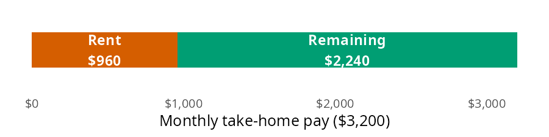
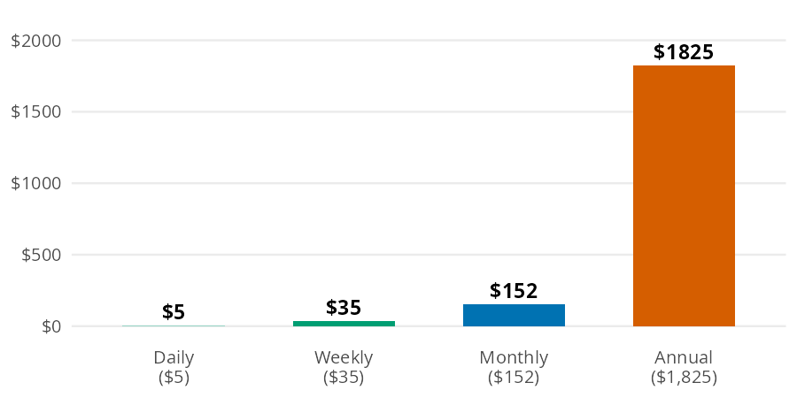
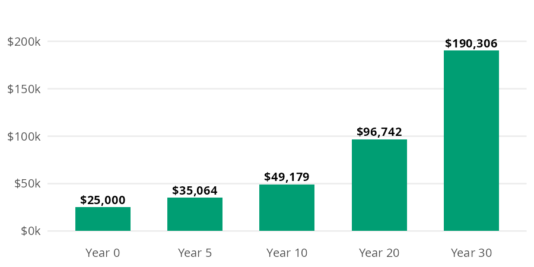
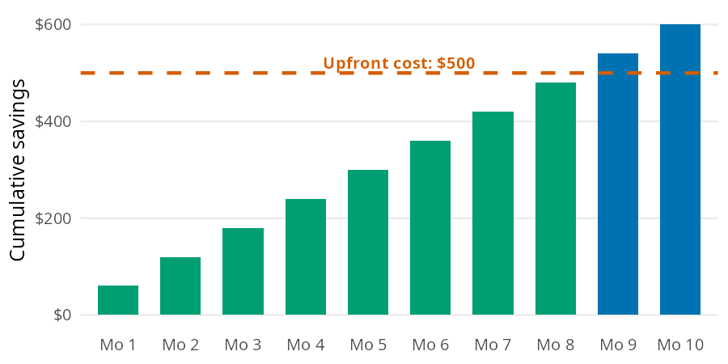

```{r}
#| label: setup
#| include: false
library(perfinr)
```

Most budgeting decisions come down to a handful of small calculations. You need to know how big a slice of your paycheck an expense takes and what a daily habit costs over a year. You also need to know what money spent today could have grown into, and how long an upfront purchase takes to pay for itself. The [Budgeting](https://mjfrigaard.github.io/fm-finance/budgeting.html) chapter of the book builds each of these from scratch. In this vignette I'll answer the same questions with `percent_of_income()`, `to_annual()`, `to_monthly()`, `opportunity_cost()`, and `months_to_break_even()`, using the chapter's numbers so you can check every result against the book.

## The budgeting functions

All five functions are vectorized, and they follow the conventions in [perfinr](perfinr.html): rates go in as decimals and ratios come out as percents.

| Function | Returns | Units |
|---|---|---|
| `percent_of_income()` | an expense as a share of income | percent (`30` is 30%) |
| `to_annual()` | a daily, weekly, or monthly amount per year | dollars per year |
| `to_monthly()` | a daily, weekly, or annual amount per month | dollars per month |
| `opportunity_cost()` | what an amount could grow to if invested | dollars (`rate` is a decimal) |
| `months_to_break_even()` | months until savings cover an upfront cost | months, not rounded |

## What share of income does an expense take?

The chapter's first job example takes home \$3,200 a month and pays \$960 in rent. The question is how much of that paycheck rent claims.

Think of the monthly take home pay as a single bar. Rent is one slice of it, and the rest of the bar is what's left for everything else:

{fig-alt="Bar model: one horizontal bar for $3,200 of monthly take home pay, split into a vermillion slice labeled Rent $960 and a bluish green slice labeled Remaining $2,240. The rent slice covers just under a third of the bar."}

`percent_of_income()` divides the width of the slice by the width of the whole bar, then multiplies by 100:

```{r}
#| label: rent-share
rent_share <- percent_of_income(expense = 960, income = 3200)
rent_share
```

Rent takes `r rent_share`% of take home pay. The result is a percent, not a decimal, so `30` means 30% (see the conventions table in [perfinr](perfinr.html)). The expense and the income need to cover the same period. A monthly rent against a yearly salary gives a share that is off by a factor of 12.

## What does a small habit cost over a year?

A \$5 daily coffee doesn't feel expensive, because you only ever pay \$5 at a time. The same habit looks very different at longer time scales:

{fig-alt="Bar chart of the same $5 a day coffee habit at four time scales: daily $5, weekly $35, monthly $152, and annual $1,825. The annual bar towers over the other three, which barely rise above zero."}

Each bar is the one before it scaled by the number of periods it contains. `to_annual()` makes the daily to yearly jump in one step:

```{r}
#| label: coffee-annual
coffee_year <- to_annual(amount = 5, period = "daily")
coffee_year
```

The coffee habit costs \$`r format(coffee_year, big.mark = ",")` a year. Suddenly it's a real number you can evaluate.

### Most budgets work in months

`to_monthly()` goes in the other direction. It converts a daily, weekly, or annual amount to a monthly one, which is the unit most budgets use. Here is the coffee habit per month:

```{r}
#| label: coffee-monthly
coffee_month <- to_monthly(amount = 5, period = "daily")
coffee_month
```

Coffee runs \$`r format(coffee_month, nsmall = 2)` a month, which matches the monthly bar above. The chapter's second example converts \$150 a week in groceries to a monthly amount:

```{r}
#| label: groceries-monthly
groceries_month <- to_monthly(amount = 150, period = "weekly")
groceries_month
```

Groceries come to \$`r format(groceries_month, nsmall = 2)` a month. That is more than four weeks' worth, because a month holds about 4.33 weeks.

## What could the money have become?

The chapter frames opportunity cost with a car. Buying a used one for \$15,000 instead of a new one for \$40,000 frees up \$25,000, which the chapter invests at 7% a year. Every dollar spent isn't just that dollar; it's what that dollar could have become.

{fig-alt="Bar chart of $25,000 invested at 7% a year, with bluish green bars at year 0 ($25,000), year 5 ($35,064), year 10 ($49,179), year 20 ($96,742), and year 30 ($190,306). Each bar is taller than the last, and the gaps between them widen over time."}

Each year multiplies the previous bar by 1.07. `opportunity_cost()` compounds the amount over the full horizon, with the rate as a decimal:

```{r}
#| label: car-gap
car_gap <- opportunity_cost(amount = 25000, rate = 0.07, years = 30)
car_gap
```

After 30 years, the \$25,000 gap grows to about \$`r format(round(car_gap), big.mark = ",")`. That's not a car payment difference; that's a retirement chapter.

## When does an upfront cost pay for itself?

Some purchases cost money now to save money later: a membership, a better phone plan, or a used bike for commuting. The chapter's example is a \$500 membership that saves \$60 a month.

{fig-alt="Bar chart of cumulative savings at $60 a month over 10 months, rising from $60 in month 1 to $600 in month 10, with a dashed vermillion line marking the $500 upfront cost. Months 1 through 8 are bluish green and sit below the line; months 9 and 10 are blue and rise above it."}

Each month the cumulative savings bar grows by \$60, and break even is the first month that bar crosses the \$500 line. `months_to_break_even()` divides the upfront cost by the monthly savings:

```{r}
#| label: membership
be_months <- months_to_break_even(upfront_cost = 500, monthly_savings = 60)
be_months
```

The membership pays for itself after `r round(be_months, 1)` months. The result isn't rounded. Use `ceiling()` to find the first whole month you come out ahead: month `r ceiling(be_months)`, the first bar above the line in the bar model. If you'll keep the membership longer than that, it's worth the upfront cost.

## Variations

Vectorized inputs let one call answer several versions of the same question. The chapter's periodic expenses are a good example. Setting aside one twelfth of each annual cost every month builds a sinking fund (money saved each month for a known future expense). `to_monthly()` converts every expense at once:

```{r}
#| label: sinking-funds
sinking <- data.frame(
  expense = c("car insurance", "gifts", "car maintenance", "vacation"),
  annual = c(1200, 600, 1200, 2400)
)
sinking$monthly <- to_monthly(amount = sinking$annual, period = "annual")
sinking
```

Together these periodic expenses need \$`r sum(sinking$monthly)` a month. When a bill arrives, the money is already there.

### One call compares every time horizon

The same approach works for time horizons. Passing several values to `years` reproduces each checkpoint in the car bar model:

```{r}
#| label: car-gap-horizons
data.frame(
  years = c(0, 5, 10, 20, 30),
  value = opportunity_cost(amount = 25000, rate = 0.07, years = c(0, 5, 10, 20, 30))
)
```

::: {.callout-warning title="Limits"}
`to_monthly()` uses rounded factors (30.44 days and 4.33 weeks per month), while `to_annual()` uses 365 days and 52 weeks per year. A round trip through both functions drifts slightly. The weekly grocery bill gives a different yearly total depending on the path:

```{r}
#| label: round-trip
to_annual(amount = 150, period = "weekly")
to_annual(amount = groceries_month, period = "monthly")
```

A few other limits apply:

* `to_annual()` accepts `"daily"`, `"weekly"`, or `"monthly"`, and `to_monthly()` accepts `"daily"`, `"weekly"`, or `"annual"`. Any other `period` is an error.
* `opportunity_cost()` assumes the same return every year and ignores inflation, taxes, and fund fees.
* `months_to_break_even()` assumes the savings are the same every month and ignores what the upfront cost could have earned if invested.
* `percent_of_income()` and `months_to_break_even()` stop with an error when `income` or `monthly_savings` is zero or negative.
:::

## Putting it together

Back to the \$3,200 first job budget. The sections above produced four monthly costs: rent, groceries, coffee, and sinking funds. `percent_of_income()` takes the whole column at once, so one call shows how much of the paycheck each category claims:

```{r}
#| label: budget
budget <- data.frame(
  category = c("rent", "groceries", "coffee", "sinking funds"),
  monthly = c(960, groceries_month, coffee_month, sum(sinking$monthly))
)
budget$percent <- round(percent_of_income(expense = budget$monthly, income = 3200), 1)
budget
```

These four categories take `r round(percent_of_income(expense = sum(budget$monthly), income = 3200), 1)`% of take home pay, which leaves \$`r format(round(3200 - sum(budget$monthly), 2), nsmall = 2)` a month for investments, savings, and fun money.

Coffee is the smallest line in the budget, but it's also the easiest to change. The code below invests one year of coffee money at 7% for 30 years instead:

```{r}
#| label: coffee-invested
coffee_invested <- opportunity_cost(amount = coffee_year, rate = 0.07, years = 30)
coffee_invested
```

One year of \$5 coffees could grow to about \$`r format(round(coffee_invested), big.mark = ",")`. That doesn't mean you should give up coffee; it means the choice now has a price you can see. The [Tracking Spending](tracking-spending.html) vignette applies the same idea to recurring costs with `subscription_opportunity_cost()`.

## Recap

Budgeting math is middle school math, and these five functions cover the calculations the chapter relies on most. `percent_of_income()` shows how big a slice each expense takes, `to_annual()` and `to_monthly()` put costs on the same time scale, and `opportunity_cost()` and `months_to_break_even()` put a price on spending decisions. Because each one is vectorized, a single call can compare a whole budget, a list of periodic expenses, or several time horizons.

* [Budgeting](https://mjfrigaard.github.io/fm-finance/budgeting.html) in Personal Finance: a field manual
* Reference: `percent_of_income()`, `to_annual()`, `to_monthly()`, `opportunity_cost()`, `months_to_break_even()`
* Next: [Managing Debt](managing-debt.html)
