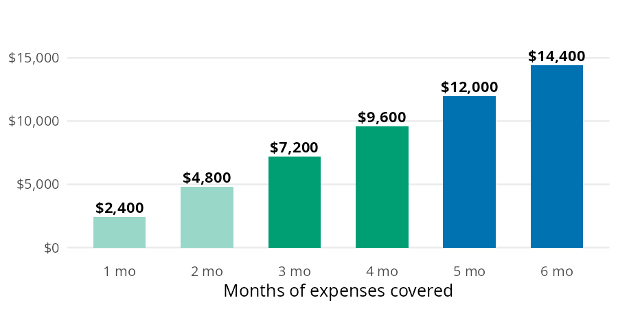
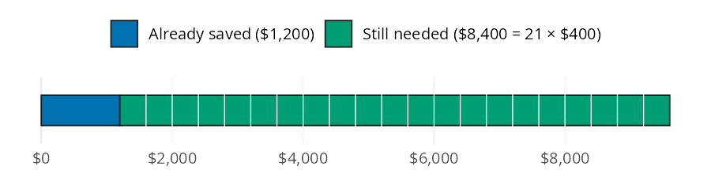
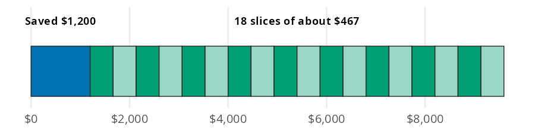
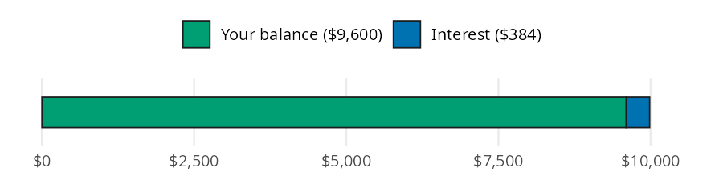
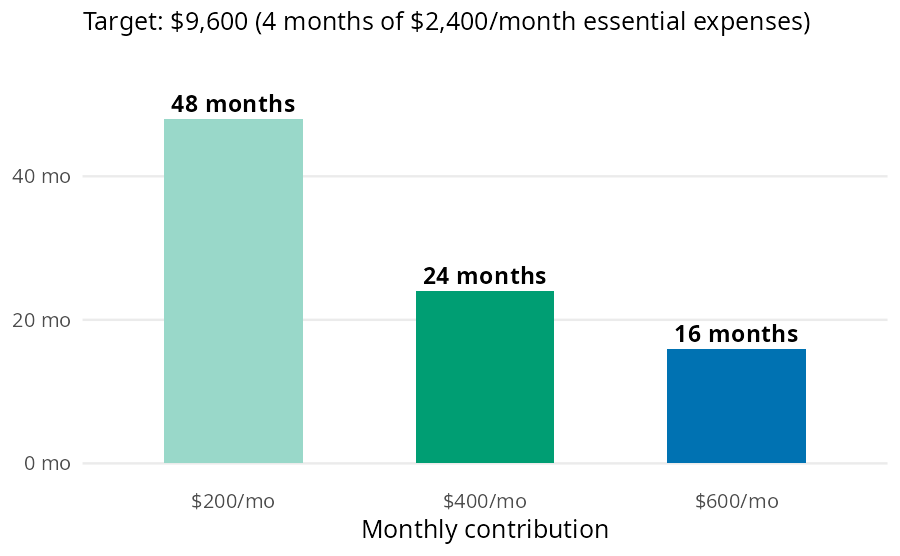

```{r}
#| label: setup
#| include: false
library(perfinr)
```

An emergency fund is cash set aside so a car repair or a job loss doesn't end up on a credit card. Building one comes down to four questions. How big should the fund be, and how long will it take to fill? How much should you save each month to finish by a deadline, and what does the fund earn in a savings account? perfinr answers them with `emergency_fund_target()`, `months_to_ef_goal()`, `monthly_contribution_needed()`, and `ef_growth()`. The examples below use the numbers from the [Emergency Fund](https://mjfrigaard.github.io/fm-finance/emergency_fund.html) chapter of the book, where each formula is built from scratch.

## The emergency fund functions

Each function answers one of the four questions:

| Function | Returns | Units |
|---|---|---|
| `emergency_fund_target()` | target balance | dollars |
| `months_to_ef_goal()` | months until the target is met, rounded up | whole months |
| `monthly_contribution_needed()` | monthly savings needed to meet a deadline, rounded up | whole dollars |
| `ef_growth()` | balance after interest | dollars |

All four are vectorized. The `apy` argument in `ef_growth()` follows the decimal convention from [perfinr](perfinr.html), so `0.04` is 4%.

## How big should the fund be?

The standard target is 3 to 6 months of essential expenses: housing, groceries, utilities, transportation, health insurance, and minimum debt payments. Dining out and subscriptions don't count, because those are the first things to go in a real emergency. The book's example is a first job with $2,400 a month in essential expenses.

Each bar below is the one before it plus one more month of expenses.

{fig-alt="Bar chart of emergency fund targets for 1 to 6 months of $2,400 monthly expenses: $2,400, $4,800, $7,200, $9,600, $12,000, and $14,400. Each bar is one month of expenses taller than the one before it. The 1 and 2 month bars are light green, the 3 and 4 month bars are bluish green, and the 5 and 6 month bars are blue."}

`emergency_fund_target()` multiplies monthly expenses by `months` (3 by default). The code below computes both ends of the standard range:

```{r}
#| label: ef-target
target_3 <- emergency_fund_target(monthly_expenses = 2400, months = 3)
target_6 <- emergency_fund_target(monthly_expenses = 2400, months = 6)
target_3
target_6
```

The range runs from $`r format(target_3, big.mark = ",")` to $`r format(target_6, big.mark = ",")`. A stable salary with good insurance sits near the low end; variable income or dependents push toward the high end. The rest of the book's examples split the difference at 4 months:

```{r}
#| label: ef-target-4
target <- emergency_fund_target(monthly_expenses = 2400, months = 4)
target
```

## How long will it take to fill?

Most people don't start from zero. Say $1,200 is already saved toward the 4 month target, and $400 goes into the fund each month.

Think of the target as one bar. The saved part is already filled in, and the gap is cut into $400 slices; counting the slices gives the number of months.

{fig-alt="Bar model: a single $9,600 bar. The first $1,200 is a blue block labeled already saved. The remaining $8,400 is a bluish green block divided into 21 equal $400 slices, labeled still needed."}

`months_to_ef_goal()` subtracts the current balance from the target and divides the gap by the monthly contribution:

```{r}
#| label: ef-months
saved <- 1200
months_needed <- months_to_ef_goal(
  target = target,
  current_balance = saved,
  monthly_contribution = 400
)
months_needed
```

The $`r format(target - saved, big.mark = ",")` gap takes `r months_needed` months, or about `r round(months_needed / 12, 1)` years. The result is rounded up to whole months, because a partial month still means one more transfer.

## How much should you save to meet a deadline?

Now flip the question. The target is still $9,600 with $1,200 saved, but the goal is to finish in 18 months.

This time the number of slices is fixed at one per month. The question is how wide each slice has to be.

{fig-alt="Bar model: a single $9,600 bar. The first $1,200 is a blue block labeled saved $1,200. The remaining $8,400 is split into 18 equal slices in alternating bluish green and light green, labeled 18 slices of about $467."}

`monthly_contribution_needed()` divides the same gap by the number of months instead:

```{r}
#| label: ef-contrib
deadline <- 18
contribution <- monthly_contribution_needed(
  target = target,
  current_balance = saved,
  months = deadline
)
contribution
```

Saving $`r contribution` a month closes the gap in `r deadline` months. The function rounds up to the next whole dollar, so the payments add up to $`r format(contribution * deadline, big.mark = ",")`: enough to cover the gap with $`r contribution * deadline - (target - saved)` to spare.

## What does the fund earn while it sits?

A high yield savings account (HYSA) pays interest on the fund. Savings accounts advertise an APY (annual percentage yield), which is what the money earns in a year with monthly compounding already included. A higher APY means the fund grows faster. The book's example leaves a full $9,600 fund untouched for 12 months at 4% APY, close to what top HYSAs paid in late 2026.

The bar below shows the balance after a year: the original deposit, plus a thin slice of interest on the end.

{fig-alt="Bar model: a single bar after 12 months. A long bluish green block is the $9,600 balance, and a thin blue block on the end is $384 of interest, for a total just under $10,000."}

`ef_growth()` multiplies the balance by `(1 + apy)` once per year, using a fraction of a year for partial periods:

```{r}
#| label: ef-growth
grown <- ef_growth(balance = target, apy = 0.04, months = 12)
grown
```

The fund grows to $`r format(round(grown), big.mark = ",")`, which is $`r round(grown - target)` of interest. That won't change the timeline much, but it can cover a small car repair without touching the fund itself.

## Variations

The book's build chart compares three monthly contributions toward the same $9,600 target, starting from an empty account.

{fig-alt="Bar chart of months to reach a $9,600 target (4 months of $2,400 essential expenses) at three monthly contributions: 48 months at $200, 24 months at $400, and 16 months at $600. The bars are light green, bluish green, and blue."}

Because `months_to_ef_goal()` is vectorized, the whole chart is one call:

```{r}
#| label: ef-build
build <- data.frame(
  monthly = c(200, 400, 600),
  months = months_to_ef_goal(
    target = target,
    current_balance = 0,
    monthly_contribution = c(200, 400, 600)
  )
)
build
```

Doubling the contribution from $200 to $400 cuts the timeline from `r build$months[1]` months to `r build$months[2]`, and $600 gets there in `r build$months[3]`.

### Longer deadlines mean smaller payments

The same comparison works in reverse. The code below finds the monthly amount needed to close the $8,400 gap in one, one and a half, or two years:

```{r}
#| label: ef-deadlines
deadlines <- data.frame(
  months = c(12, 18, 24),
  monthly = monthly_contribution_needed(
    target = target,
    current_balance = saved,
    months = c(12, 18, 24)
  )
)
deadlines
```

Stretching the deadline from one year to two drops the monthly amount from $`r deadlines$monthly[1]` to $`r deadlines$monthly[3]`.

::: {.callout-warning}
## What these functions leave out

* `emergency_fund_target()` doesn't choose the number of months for you. The default of 3 is the low end of the range, so pass a larger `months` for variable income or dependents.
* `months_to_ef_goal()` and `monthly_contribution_needed()` ignore interest, so they slightly overstate the time and money needed when the fund sits in a HYSA. Both round up and return 0 when the balance already meets the target.
* `monthly_contribution` and `months` must be greater than 0. A zero stops with an error instead of returning `Inf`.
* `ef_growth()` assumes the APY stays fixed and nothing goes in or out during the period. Pass the APY as a decimal (`0.04`), not a percent (`4`).
:::

## Putting it together

The book's order matters here. A $1,000 starter fund comes first, then high interest debt (see [Managing Debt](managing-debt.html)), and then the full fund. The scenario below picks up at the last step: $2,400 a month in essential expenses, a 4 month target, $1,200 already saved, and an 18 month deadline. `percent_of_income()` from [Budgeting](budgeting.html) shows how much of a $3,200 take home paycheck the plan uses.

```{r}
#| label: ef-plan
plan_target <- emergency_fund_target(monthly_expenses = 2400, months = 4)
plan_monthly <- monthly_contribution_needed(
  target = plan_target,
  current_balance = 1200,
  months = 18
)
plan_months <- months_to_ef_goal(
  target = plan_target,
  current_balance = 1200,
  monthly_contribution = plan_monthly
)
plan_share <- percent_of_income(expense = plan_monthly, income = 3200)
plan_interest <- ef_growth(balance = plan_target, apy = 0.04, months = 12) - plan_target
data.frame(
  step = c("target", "monthly contribution", "months to goal",
           "percent of take home pay", "first year of interest"),
  value = round(c(plan_target, plan_monthly, plan_months, plan_share, plan_interest), 1)
)
```

Saving $`r plan_monthly` a month takes `r round(plan_share, 1)`% of the paycheck. Feeding that contribution back into `months_to_ef_goal()` returns `r plan_months` months, which confirms the plan meets the deadline. Once the fund is full, a year in a HYSA adds $`r round(plan_interest)` without any new deposits. [Automating Savings](automating-savings.html) covers setting up the monthly transfer, and [High-Yield Savings Accounts](high-yield-accounts.html) covers choosing the account.

## Recap

An emergency fund comes down to four numbers. They are the target, the months to reach it, the monthly amount a deadline requires, and the interest earned along the way. `emergency_fund_target()`, `months_to_ef_goal()`, `monthly_contribution_needed()`, and `ef_growth()` compute each one. All four accept vectors, so comparing contributions or deadlines takes a single call.

* [Emergency Fund](https://mjfrigaard.github.io/fm-finance/emergency_fund.html) in Personal Finance: a field manual
* `emergency_fund_target()`
* `months_to_ef_goal()`
* `monthly_contribution_needed()`
* `ef_growth()`
