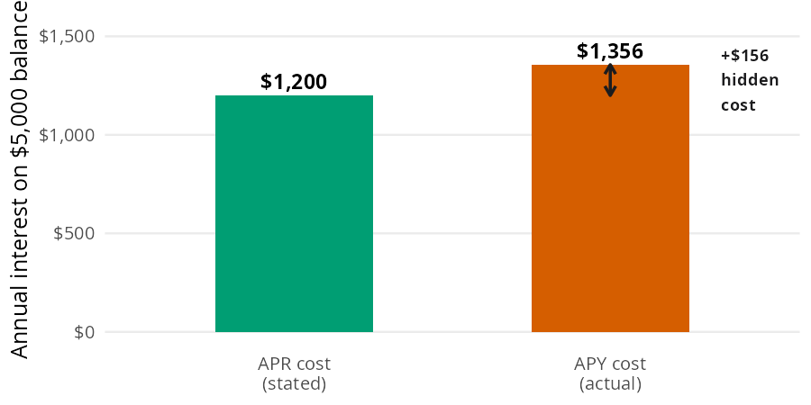
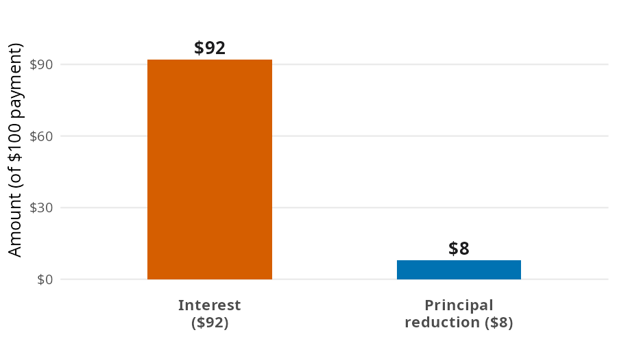
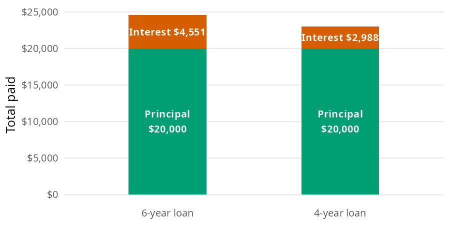
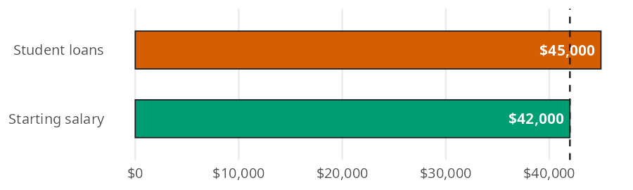
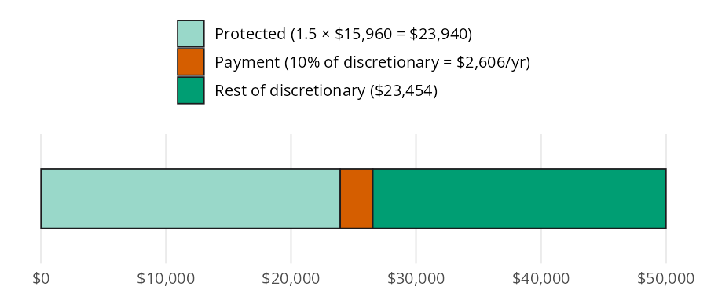
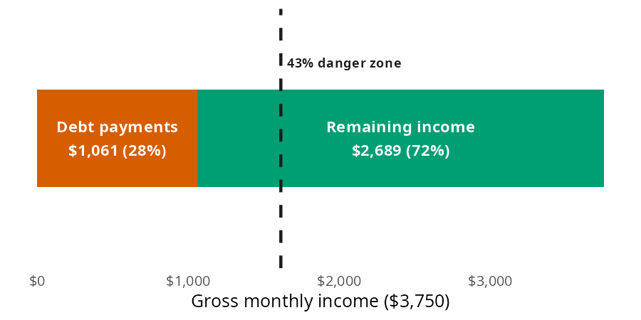
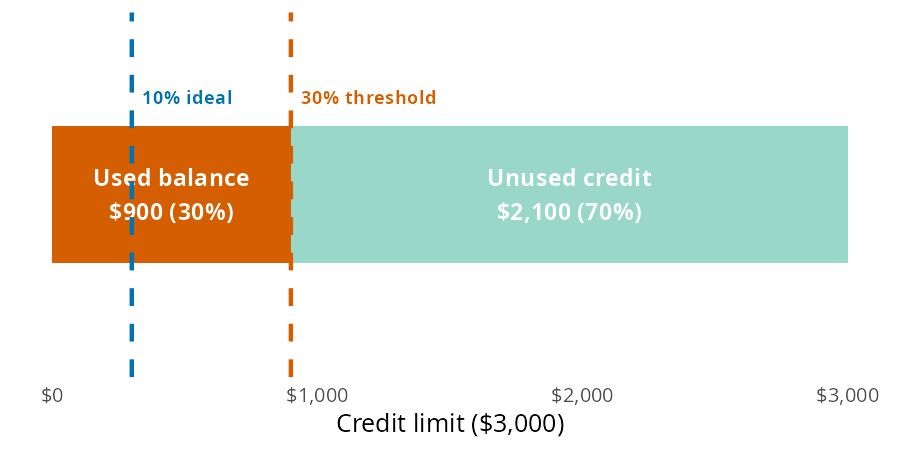
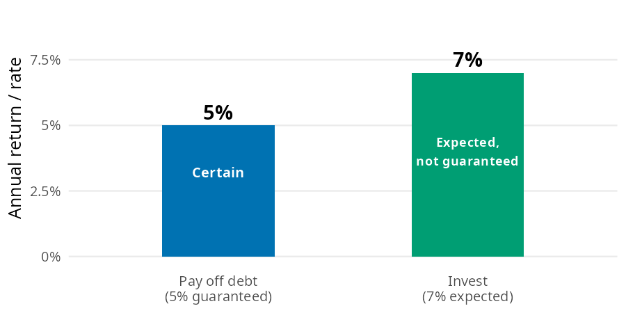
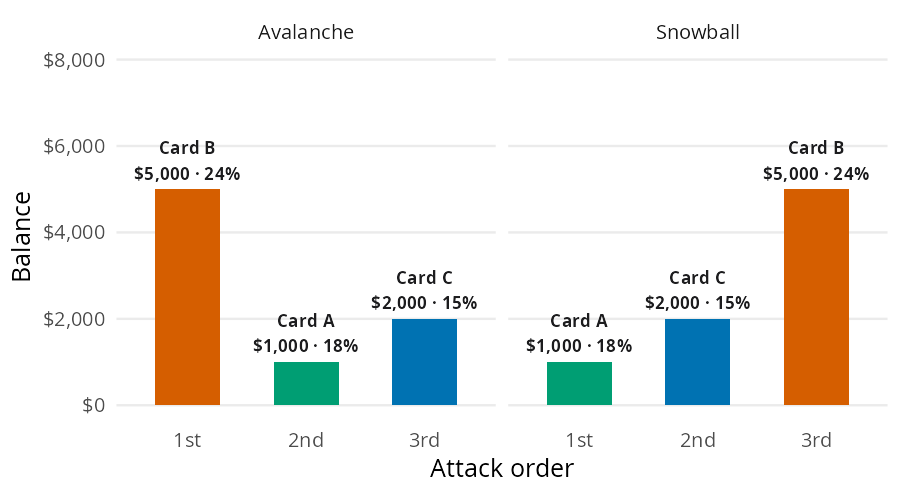

```{r}
#| label: setup
#| include: false
library(perfinr)
```

Lenders quote whichever number makes a loan look cheapest, and they count on borrowers not running the math. The book's [Managing Debt](https://mjfrigaard.github.io/fm-finance/managing_debt.html) chapter runs that math. It asks what a balance really costs, how much student debt a salary can carry, which ratios lenders check, and which debt to pay first. In this vignette I'll answer the same questions with perfinr's 11 managing debt functions. Each example uses the chapter's numbers, so you can check every result against the book.

## The managing debt functions

The functions follow the conventions in [perfinr](perfinr.html): rates go in as decimals and ratios come out as percents. The one exception to watch is `loan_income_ratio()`, which returns a plain ratio rather than a percent.

| Function | Returns | Units |
|---|---|---|
| `apr_to_apy()` | the effective yearly rate of an APR | decimal (`0.27` is 27%) |
| `months_to_payoff()` | months to clear a balance with a fixed payment | months, not rounded |
| `total_interest()` | all payments minus the amount borrowed | dollars |
| `loan_income_ratio()` | student loans relative to starting salary | ratio (`1` is one year of salary) |
| `monthly_standard_payment()` | payment on a standard student loan plan | dollars per month |
| `idr_monthly_payment()` | payment on an income driven repayment plan | dollars per month, rounded to cents |
| `dti_ratio()` | debt payments as a share of gross income | percent (`28` is 28%) |
| `payoff_vs_invest()` | whether to pay off a loan or invest | a single string |
| `order_avalanche()` | debts sorted by APR, highest first | a data frame |
| `order_snowball()` | debts sorted by balance, smallest first | a data frame |
| `credit_utilization()` | a card balance as a share of the limit | percent (`30` is 30%) |

## What does a balance really cost?

Every debt has a price, called the APR (annual percentage rate): the yearly cost of borrowing, shown as a percent of what you owe. The APR is only the starting point. Compounding, slow payments, and long terms all add to what you pay, and the three functions in this section measure each one.

### APR vs. APY

The chapter's example is a credit card with a 24% APR that compounds daily, carrying a \$5,000 balance. Credit card companies quote the APR, but compounding (charging interest on interest you haven't paid yet) means the balance grows faster than the APR suggests.

Both bars below represent one year of interest on the same balance. The shorter bar is what the APR implies; the taller bar is what you actually owe:

{fig-alt="Bar chart of one year of interest on a $5,000 balance. The bluish green APR cost bar, labeled stated, reaches $1,200. The vermillion APY cost bar, labeled actual, reaches $1,356, and a double headed arrow at its top marks the $156 difference as hidden cost."}

The APY (annual percentage yield) is the effective yearly rate once compounding is included. `apr_to_apy()` converts one to the other, with `periods_per_year` defaulting to 365 for daily compounding:

```{r}
#| label: apr-apy
apy <- apr_to_apy(apr = 0.24)
apy
```

A 24% APR compounded daily is really `r round(apy * 100, 1)`% a year. On the \$5,000 balance, that gap is about \$`r round(5000 * (apy - 0.24))` of interest the quoted rate never mentions.

### How long does a minimum payment take?

The chapter's next example is a \$5,000 balance at 22% APR with a \$100 minimum payment. A \$100 payment sounds reasonable until you see how little of it reaches the balance. The principal is the amount you borrowed; interest is what the lender charges on top.

{fig-alt="Bar chart splitting a $100 payment into two bars. A tall vermillion bar shows $92 going to interest, and a short blue bar shows $8 going to principal reduction."}

Only the principal slice shrinks the debt. As the balance falls, the interest slice shrinks too, so each payment retires a little more principal than the one before. `months_to_payoff()` accounts for that, compounding interest monthly at `apr / 12`:

```{r}
#| label: min-payoff
first_interest <- 5000 * 0.22 / 12
first_interest
card_months <- months_to_payoff(balance = 5000, monthly_payment = 100, apr = 0.22)
card_months
```

The first month's interest is about \$`r round(first_interest)`, so only \$`r round(100 - first_interest)` of the first payment touches the balance. Paying the minimum clears the card in about `r round(card_months)` months (`r round(card_months / 12, 1)` years), and the payments add up to about \$`r format(round(100 * card_months), big.mark = ",")` on a \$5,000 balance. Minimum payments are designed to keep you in debt for years.

### What does the loan term cost?

An installment loan is one you repay in equal monthly payments, like a car loan or a mortgage. For these loans, total interest is the number that should drive the decision. The chapter's example is a \$20,000 used car loan at 7%. It runs either 6 years at \$340.98 a month or 4 years at \$478.92 a month.

The amount borrowed is the same either way. The bars below stack the principal and interest layers, so the cost of the longer term is visible:

{fig-alt="Two stacked bars of total paid on a $20,000 car loan. The 6-year loan stacks a $4,551 vermillion interest layer on a $20,000 bluish green principal layer. The 4-year loan stacks a thinner $2,988 interest layer on the same $20,000 of principal."}

Subtract the principal from everything you pay and the interest layer is what's left. `total_interest()` is vectorized, so both terms fit in one call:

```{r}
#| label: total-interest
car_interest <- total_interest(
  monthly_payment = c(340.98, 478.92),
  n_months = c(72, 48),
  principal = 20000
)
car_interest
```

The 6-year loan costs \$`r formatC(car_interest[1], format = "f", digits = 2, big.mark = ",")` in interest, and the 4-year loan costs \$`r formatC(car_interest[2], format = "f", digits = 2, big.mark = ",")`. Shortening the term saves \$`r formatC(car_interest[1] - car_interest[2], format = "f", digits = 2, big.mark = ",")`, which is the math behind the 20/4/10 car rule (20% down, no more than 4 years, transportation under 10% of gross income).

## How much student debt can a salary carry?

Student loans sit in a complicated middle ground. Education is an investment in your future earning potential, but only when the math works. The chapter gives two tools for checking it: the 1x rule before you borrow, and income driven repayment after.

### The 1x rule

The 1x rule says total student debt at graduation should not exceed your expected first year salary. The chapter's example borrower has \$45,000 in loans and a \$42,000 starting salary, repaying on a standard 10 year plan at 6.5%.

Picture what you borrowed and what your first job pays as two bars side by side. The rule says the loan bar shouldn't run past the salary bar:

{fig-alt="Two horizontal bars. The vermillion student loans bar is $45,000 and the bluish green starting salary bar is $42,000. A dashed vertical line at $42,000 marks the end of the salary bar, and the loan bar runs a little past it."}

`loan_income_ratio()` divides the loan bar by the salary bar. `monthly_standard_payment()` then spreads the loan, plus interest, over 120 equal payments, with the 6.5% rate and 10 year term as defaults:

```{r}
#| label: loan-income
ratio <- loan_income_ratio(loan_total = 45000, expected_salary = 42000)
ratio
student_payment <- monthly_standard_payment(principal = 45000)
student_payment
```

The ratio is `r round(ratio, 2)`, so this borrower is a little over the 1x rule. The standard payment is about \$`r round(student_payment)` a month, or roughly \$`r round(student_payment / 45000, 4)` a month for every dollar borrowed. The 1x rule is a ceiling, not a target; lower earning majors often need a lower personal cap.

### Income driven repayment

When the 1x rule is out of reach, federal income driven repayment (IDR) plans cap payments as a share of discretionary income. Discretionary income is your AGI (adjusted gross income, from your tax return) minus a protected multiple of the Federal Poverty Guideline. The chapter's example is a \$50,000 AGI under IBR. IBR protects 1.5 times the 2026 guideline (\$15,960) and charges 10% on whatever is left.

Think of the AGI as one bar. The plan protects the first part of it, and the payment is a small slice of what's left:

{fig-alt="A single horizontal bar for $50,000 of AGI, split into three segments. A light bluish green segment of $23,940 is protected income (1.5 times $15,960). A narrow vermillion segment of $2,606 a year is the payment (10% of discretionary income). A bluish green segment of $23,454 is the rest of discretionary income."}

`idr_monthly_payment()` subtracts the protected part, takes the payment rate of what's left, and divides by 12. The defaults are the IBR terms for loans from July 2014 on; older IBR loans use a 15% rate:

```{r}
#| label: idr-payment
ibr <- idr_monthly_payment(agi = 50000)
ibr
ibr_old <- idr_monthly_payment(agi = 50000, payment_rate = 0.15)
ibr_old
```

IBR comes to \$`r format(ibr, nsmall = 2)` a month, and \$`r format(ibr_old, nsmall = 2)` for loans made before July 2014. IDR plans change with Congress, the courts, and the Department of Education, so check current terms at [studentaid.gov](https://studentaid.gov/manage-loans/repayment/plans) before enrolling.

## What ratios do lenders check?

Lenders don't just look at what you owe; they look at how much of your income and credit is already spoken for. These two ratios are what lenders calculate about you, so it pays to calculate them about yourself first.

### Debt to income ratio

The chapter pictures a first job paying \$45,000 a year, or \$3,750 a month in gross income. Its debts are a \$511 student loan payment, a \$450 car payment, and \$100 in credit card minimums. Gross income is your pay before taxes, and the bar below splits it into what goes to debt and what's left:

{fig-alt="A horizontal bar for $3,750 of gross monthly income. A vermillion segment of $1,061 (28%) is debt payments, and a bluish green segment of $2,689 (72%) is remaining income. A dashed line marks the 43% danger zone, to the right of where the debt segment ends."}

DTI (debt to income) is just the debt slice as a share of the whole bar. `dti_ratio()` returns it as a percent:

```{r}
#| label: dti
debt_payments <- c(student_loan = 511, car = 450, cards = 100)
dti <- dti_ratio(
  monthly_debt_payments = sum(debt_payments),
  gross_monthly_income = 45000 / 12
)
dti
```

The \$`r format(sum(debt_payments), big.mark = ",")` in monthly debt payments take about `r round(dti)`% of gross income. The chapter calls 20% to 35% manageable but worth watching; above 43%, most mortgage lenders won't approve you.

### Credit utilization

Credit utilization is how much of your available credit you're using. Credit scores penalize high utilization because using most of your available credit is a sign of money trouble. The chapter's example is a \$900 balance on a first card with a \$3,000 limit:

{fig-alt="A horizontal bar for a $3,000 credit limit. A vermillion segment of $900 (30%) is the used balance, and a light bluish green segment of $2,100 (70%) is unused credit. A blue dashed line marks the 10% ideal at $300, and a vermillion dashed line marks the 30% threshold, exactly where the used balance ends."}

`credit_utilization()` divides the used slice by the whole limit and returns a percent:

```{r}
#| label: utilization
utilization <- credit_utilization(balance = 900, credit_limit = 3000)
utilization
```

The card sits at `r utilization`% utilization, right at the threshold. Keep utilization under 30% on each card and across all cards; under 10% (a \$`r 3000 * 0.10` balance on this card) is ideal.

## Which debt should you pay first?

Not all debt is created equal. Attack it in order of damage potential. This section covers two versions of that decision. The first is whether extra money should go to a loan or to investments; the second is which of several debts to attack first.

### Pay off or invest?

The chapter compares a 5% student loan against an expected 7% stock market return. The math slightly favors investing, but the bar model adds what the math alone misses:

{fig-alt="Two bars of annual return. The blue pay off debt bar reaches 5% and is labeled certain. The taller bluish green invest bar reaches 7% and is labeled expected, not guaranteed."}

`payoff_vs_invest()` compares the two rates (as decimals) and returns the option that wins on paper:

```{r}
#| label: payoff-vs-invest
loan_rate <- 0.05
expected_return <- 0.07
payoff_vs_invest(loan_rate = loan_rate, expected_return = expected_return)
```

Investing wins by about `r round((expected_return - loan_rate) * 100, 1)` percentage points a year. But the return from paying off the loan is guaranteed, and the investment return is not. A guaranteed 5% beats a probable 7% for many people psychologically, so run the math, then add your peace of mind premium.

### Avalanche vs. snowball

The chapter's example has three credit cards: Card A (\$1,000 at 18%), Card B (\$5,000 at 24%), and Card C (\$2,000 at 15%). The avalanche method pays the highest APR first; the snowball method pays the smallest balance first. Both attack the same three debts, just in a different order:

{fig-alt="Two panels of bars showing the attack order for three cards. The avalanche panel goes Card B ($5,000 at 24%) first, Card A ($1,000 at 18%) second, and Card C ($2,000 at 15%) third. The snowball panel goes Card A first, Card C second, and Card B third."}

Both functions take a data frame of debts and return it sorted. `order_avalanche()` needs an `apr` column, and `order_snowball()` needs a `balance` column:

```{r}
#| label: avalanche-snowball
debts <- data.frame(
  name = c("Card A", "Card B", "Card C"),
  balance = c(1000, 5000, 2000),
  apr = c(0.18, 0.24, 0.15)
)
order_avalanche(debts)
order_snowball(debts)
```

Avalanche wins on paper because a dollar sent to the highest APR stops the most interest. The code below shows how much interest an extra \$100 stops next month on each card:

```{r}
#| label: extra-payment
extra_saved <- 100 * debts$apr / 12
names(extra_saved) <- debts$name
extra_saved
```

An extra \$100 on Card B stops \$`r format(extra_saved[["Card B"]], nsmall = 2)` of interest, compared with \$`r format(extra_saved[["Card A"]], nsmall = 2)` on Card A. Snowball pays off Card A first, which costs a little more but delivers a win sooner. If that quick win is the price of actually finishing, it's often worth it; if you're disciplined enough for avalanche, take the savings.

## Variations

Most of these functions are vectorized, so one call can compare several versions of the same decision. Raising the credit card payment from the minimum shows how fast the payoff time and the interest fall:

```{r}
#| label: vary-card-payment
card_payment <- c(100, 150, 200, 300)
card_payoff <- months_to_payoff(balance = 5000, monthly_payment = card_payment, apr = 0.22)
card_cost <- total_interest(monthly_payment = card_payment, n_months = card_payoff, principal = 5000)
data.frame(payment = card_payment, months = card_payoff, interest = card_cost)
```

Doubling the payment from \$100 to \$200 cuts the interest from about \$`r format(round(card_cost[1]), big.mark = ",")` to about \$`r format(round(card_cost[3]), big.mark = ",")`, and the card is gone in `r ceiling(card_payoff[3])` months instead of `r ceiling(card_payoff[1])`.

The car loan payments in the total interest example come from the same amortization formula that `monthly_standard_payment()` uses. Changing the rate to 7% and passing several terms reproduces them, along with the interest for each term:

```{r}
#| label: vary-car-term
car_years <- c(3, 4, 5, 6)
car_payment <- monthly_standard_payment(principal = 20000, annual_rate = 0.07, years = car_years)
data.frame(
  years = car_years,
  payment = car_payment,
  interest = total_interest(monthly_payment = car_payment, n_months = car_years * 12, principal = 20000)
)
```

The IDR plans differ only in the protected multiple and the payment rate, so `idr_monthly_payment()` can compare them for the same \$50,000 AGI. SAVE protected 225% of the guideline and charged 5% on undergraduate loans before it ended in March 2026:

```{r}
#| label: vary-idr-plans
idr_plans <- data.frame(
  plan = c("IBR (loans from July 2014)", "IBR (loans before July 2014)", "SAVE (ended 2026)"),
  threshold_pct = c(1.5, 1.5, 2.25),
  payment_rate = c(0.10, 0.15, 0.05)
)
idr_plans$monthly <- idr_monthly_payment(
  agi = 50000,
  threshold_pct = idr_plans$threshold_pct,
  payment_rate = idr_plans$payment_rate
)
idr_plans
```

## What these functions don't model

::: {.callout-warning title="Limits"}
`months_to_payoff()` stops with an error when the payment doesn't cover the first month's interest, because the balance would never be paid off. A \$90 payment on the \$5,000 card at 22% falls short of the first month's interest:

```{r}
#| label: payoff-error
#| error: true
months_to_payoff(balance = 5000, monthly_payment = 90, apr = 0.22)
```

A few other limits apply:

* `months_to_payoff()` and `apr_to_apy()` assume a constant rate and no new charges. The months aren't rounded, so the last payment is a partial one.
* `total_interest()` uses whatever payment you give it. A payment rounded to cents gives a total that differs from the exact one by a few cents.
* `idr_monthly_payment()` defaults to the 2026 poverty guideline for one person in the contiguous U.S. It doesn't cover RAP, which bases payments on total AGI instead of discretionary income.
* `payoff_vs_invest()` takes single values only and compares the rates exactly as given. It ignores taxes and risk, and only identical rates count as a wash.
* `order_avalanche()` and `order_snowball()` sort the debts; they don't simulate the payoff or total the interest under each method.
:::

## Putting it together

Picture a first job paying \$45,000 a year, with \$45,000 in federal student loans, a car loan, and one credit card. The first question is whether the loans fit the 1x rule, and what repaying them costs on the standard plan versus IBR:

```{r}
#| label: together-loans
salary <- 45000
standard <- monthly_standard_payment(principal = 45000)
c(
  ratio = loan_income_ratio(loan_total = 45000, expected_salary = salary),
  standard = standard,
  ibr = idr_monthly_payment(agi = salary)
)
```

The loans sit exactly at the 1x ceiling, so the standard plan is affordable. Next, we can add the car loan (\$15,000 at 7%, \$450 a month) and the card (\$900 at 22%, \$100 a month, \$3,000 limit). Then we check the two ratios lenders use:

```{r}
#| label: together-ratios
first_job <- data.frame(
  name = c("Student loan", "Car loan", "Credit card"),
  balance = c(45000, 15000, 900),
  apr = c(0.065, 0.07, 0.22),
  payment = c(standard, 450, 100)
)
first_job_dti <- dti_ratio(
  monthly_debt_payments = sum(first_job$payment),
  gross_monthly_income = salary / 12
)
first_job_util <- credit_utilization(balance = 900, credit_limit = 3000)
c(dti = first_job_dti, utilization = first_job_util)
```

DTI is about `r round(first_job_dti)`%, in the manageable range, but the card sits at the `r first_job_util`% utilization threshold. Both ordering methods point at the same debt first:

```{r}
#| label: together-order
order_avalanche(first_job)
order_snowball(first_job)
```

The card has both the highest APR and the smallest balance, so avalanche and snowball agree. The last step checks how long the card takes at \$100 a month. It also checks whether extra money should go to each debt or to investments expected to return 7%:

```{r}
#| label: together-decide
card_first_job <- months_to_payoff(balance = 900, monthly_payment = 100, apr = 0.22)
card_first_job
payoff_vs_invest(loan_rate = 0.22, expected_return = 0.07)
payoff_vs_invest(loan_rate = 0.065, expected_return = 0.07)
```

The card is gone in `r ceiling(card_first_job)` months. After that, its \$100 can roll into the car loan. The student loan comparison is closer than the function's answer suggests. The edge is only `r round((0.07 - first_job$apr[1]) * 100, 1)` percentage points, and the chapter treats loans above about 6% as worth paying down. The book's [Budgeting](https://mjfrigaard.github.io/fm-finance/budgeting.html#sec-foo-intro) chapter places these steps in the Financial Order of Operations. The [Emergency Fund](emergency-fund.html) vignette covers the reserve that comes after high interest debt.

## How `monthly_standard_payment()` works

`monthly_standard_payment()` doesn't repeat the amortization formula. It passes its arguments to `mortgage_payment()` (from the [Major Purchases](major-purchases.html) vignette), which checks its inputs and calls an internal helper, `annuity_factor()`:

```{r}
#| label: call-stack
#| eval: false
lobstr::ast(
  monthly_standard_payment(
    mortgage_payment(
      check_numeric(),
      check_numeric(),
      check_positive(
        check_numeric()
      ),
      annuity_factor()
    )
  )
)
```

::: {style="font-style: italic;"}

```{verbatim}
█─monthly_standard_payment
└─█─mortgage_payment
  ├─█─check_numeric
  ├─█─check_numeric
  ├─█─check_positive
  │ └─█─check_numeric
  └─█─annuity_factor
```

:::

`annuity_factor()` is where the 0% case lives. Instead of dividing by zero, it returns the number of payments, so a 0% loan is just the principal split into equal pieces:

```{r}
#| label: zero-rate
monthly_standard_payment(principal = 12000, annual_rate = 0)
```

## Recap

Debt is a math problem dressed up in emotional clothing, and these 11 functions cover the math the chapter relies on. `apr_to_apy()`, `months_to_payoff()`, and `total_interest()` show what a balance really costs; `loan_income_ratio()`, `monthly_standard_payment()`, and `idr_monthly_payment()` size student loans against a salary. `dti_ratio()` and `credit_utilization()` return the percents lenders check, and `payoff_vs_invest()`, `order_avalanche()`, and `order_snowball()` decide where the next dollar goes.

* [Managing Debt](https://mjfrigaard.github.io/fm-finance/managing_debt.html) in Personal Finance: a field manual
* Reference: `apr_to_apy()`, `months_to_payoff()`, `total_interest()`, `loan_income_ratio()`, `monthly_standard_payment()`, `idr_monthly_payment()`, `dti_ratio()`, `payoff_vs_invest()`, `order_avalanche()`, `order_snowball()`, `credit_utilization()`
* Next: [Emergency Fund](emergency-fund.html)
