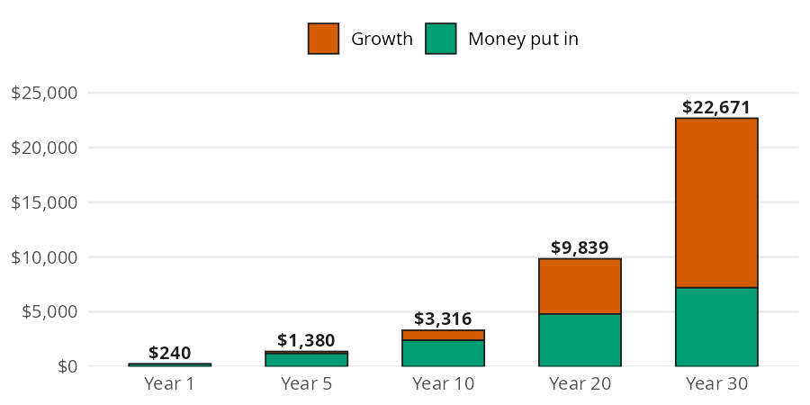

```{r}
#| label: setup
#| include: false
library(perfinr)
```

A bank export tells you every dollar that left your account, but it doesn't tell you where your money went. To answer that, each transaction needs a category, and the small recurring charges need a second look. The [Tracking Spending](https://mjfrigaard.github.io/fm-finance/tracking_spending.html) chapter of the book covers both questions. In this vignette I'll answer them with two perfinr functions. `apply_rules()` sorts transactions into buckets. `subscription_opportunity_cost()` shows what a subscription would have grown to if you had invested the money instead.

| Function | Returns | Units |
|---|---|---|
| `apply_rules()` | the transactions with a `Category` column added | text categories; `"Other"` when nothing matches |
| `subscription_opportunity_cost()` | what the yearly cost grows to if invested | dollars; `rate` is a decimal (`0.07` is 7%) |

## Where did the money go?

The book starts with a January 2026 bank export. It has the three columns most banks include: `Date`, `Description`, and `Amount` (negative for money going out, positive for money coming in). The code below builds the same statement as a base R `data.frame`:

```{r}
#| label: bank-statement
bank_statement <- data.frame(
  Date = as.Date(c(
    "2026-01-02", "2026-01-02", "2026-01-03", "2026-01-03",
    "2026-01-04", "2026-01-04", "2026-01-05", "2026-01-06",
    "2026-01-07", "2026-01-08", "2026-01-09", "2026-01-10",
    "2026-01-11", "2026-01-12", "2026-01-13", "2026-01-14",
    "2026-01-15"
  )),
  Description = c(
    "Employer Payroll",     "Rent",
    "Comcast Internet",     "Trader Joe's",
    "Shell Gas",            "Netflix",
    "Starbucks",            "PG&E Electric",
    "AT&T Wireless",        "Spotify",
    "Whole Foods",          "Chipotle",
    "Geico Auto Insurance", "NYTimes Digital",
    "Shell Gas",            "Costco",
    "24 Hour Fitness"
  ),
  Amount = c(
     2400.00, -1500.00,
      -75.00,   -82.45,
      -45.20,   -15.99,
       -6.75,  -142.30,
      -85.00,   -10.99,
      -64.12,   -14.50,
     -125.00,   -17.00,
      -42.80,  -156.78,
      -39.99
  )
)
```

The statement has `r nrow(bank_statement)` transactions and no `Category` column. To add one, we map each description to a bucket with a lookup table of keyword patterns. Each `Pattern` is a regular expression (a text search pattern), so `|` means "or" and one rule can cover several merchants:

```{r}
#| label: rules
rules <- data.frame(
  Pattern  = c("Payroll", "Rent", "Comcast|PG&E|AT&T",
               "Trader Joe|Whole Foods|Costco", "Shell",
               "Starbucks|Chipotle",
               "Netflix|Spotify|NYTimes|24 Hour Fitness", "Geico"),
  Category = c("Income", "Housing", "Utilities", "Groceries",
               "Transportation", "Dining", "Subscriptions", "Insurance")
)
```

`apply_rules()` checks the `r nrow(rules)` rules in order against each description and keeps the first match. The table below shows each transaction next to the bucket it landed in:

```{r}
#| label: categorize
categorized <- apply_rules(df = bank_statement, rules = rules)
categorized[, c("Description", "Amount", "Category")]
```

Every transaction found a bucket, so nothing fell through to `"Other"`. With a `Category` column in place, the tracking questions from the book become one line of base R. The code below totals each category:

```{r}
#| label: category-totals
totals <- aggregate(Amount ~ Category, data = categorized, FUN = sum)
totals
```

Subscriptions took $`r formatC(-totals$Amount[totals$Category == "Subscriptions"], format = "f", digits = 2, big.mark = ",")` in the first half of January. That total is small next to rent, but it repeats every month, which is why the next section looks at it more closely.

### When a transaction doesn't match

New merchants show up every month. The book's rule is "when in doubt, Other." A transaction that matches no pattern lands in `"Other"` until you've seen it often enough to deserve its own rule. The code below runs two new transactions through the same rules:

```{r}
#| label: unmatched
new_transactions <- data.frame(
  Description = c("Venmo Payment", "SPOTIFY FAMILY PLAN")
)
apply_rules(df = new_transactions, rules = rules)
```

The Venmo payment falls through to `"Other"`. The Spotify charge still lands in `"Subscriptions"` because `apply_rules()` ignores case, so `"Spotify"` matches `"SPOTIFY"`.

## What does a subscription really cost?

A subscription's real cost is its opportunity cost: the money you give up by spending instead of investing. The book's example is a monthly subscription you don't really use, with the money invested instead at a real return (the return after inflation). The code below stores the book's inputs:

```{r}
#| label: subscription-inputs
monthly_cost <- 20
years <- 30
rate <- 0.07
```

Canceling the $`r monthly_cost` a month subscription frees up $`r formatC(monthly_cost * 12, format = "d", big.mark = ",")` a year to invest at `r rate * 100`% for `r years` years. The chart below shows what that money grows into at each checkpoint, split into the money you put in and the growth it earned.

{fig-alt="Stacked bar chart of $240 a year invested at 7%, with bars at years 1, 5, 10, 20, and 30. Each bar splits into money put in (bluish green, bottom) and growth (vermillion, top). The totals are $240, $1,380, $3,316, $9,839, and $22,671. Growth is a thin sliver at year 5, about equal to the money put in at year 20, and roughly twice the money put in at year 30."}

Each bar adds another year's deposit to everything saved so far, and the whole pile grows by 7%. `subscription_opportunity_cost()` adds up every year's deposit and its growth in one step:

```{r}
#| label: subscription-cost
sub_cost <- subscription_opportunity_cost(
  monthly_cost = monthly_cost,
  years = years,
  rate = rate
)
sub_cost
```

Over `r years` years you put in $`r formatC(monthly_cost * 12 * years, format = "d", big.mark = ",")`, and growth adds $`r formatC(sub_cost - monthly_cost * 12 * years, format = "f", digits = 0, big.mark = ",")` on top of it. That "small" $`r monthly_cost` a month is a $`r formatC(sub_cost, format = "f", digits = 0, big.mark = ",")` decision.

## Comparing horizons

`subscription_opportunity_cost()` is vectorized, so one call can fill in every bar of the chart above. The code below puts the five checkpoints in a `data.frame` with the money put in and the growth:

```{r}
#| label: subscription-years
checkpoints <- c(1, 5, 10, 20, 30)
horizons <- data.frame(
  years  = checkpoints,
  put_in = monthly_cost * 12 * checkpoints,
  value  = round(subscription_opportunity_cost(monthly_cost, checkpoints, rate), 2)
)
horizons$growth <- horizons$value - horizons$put_in
horizons
```

Growth is $`r formatC(horizons$growth[horizons$years == 5], format = "f", digits = 0, big.mark = ",")` after `r checkpoints[2]` years and $`r formatC(horizons$growth[horizons$years == 30], format = "f", digits = 0, big.mark = ",")` after `r checkpoints[5]`. Most of the cost of a subscription shows up late, which is exactly when you've stopped noticing the charge.

::: {.callout-warning}
## Limits

* `apply_rules()`: the first matching rule wins, so put specific patterns above general ones. Patterns are regular expressions with case ignored, so characters like `.`, `+`, and `(` have special meanings. The function only reads `Description`; a Netflix refund lands in `"Subscriptions"` just like the charge. An existing `Category` column is replaced.
* `subscription_opportunity_cost()`: it invests the yearly total once, at the end of each year, at one fixed rate. The book's $267,000 figure for $219 a month assumes monthly deposits, so it comes out higher than this function's result for the same inputs. The 7% default is a real return, so the result is in today's dollars. It does not reject negative costs.
:::

## Putting it together

The book's monthly review ends with a subscription audit: list every recurring charge and decide whether it's worth the cost. The categorized statement already holds that list. The code below pulls the subscription rows and prices each one over the same horizon:

```{r}
#| label: subscription-audit
subs <- categorized[categorized$Category == "Subscriptions", ]
audit <- data.frame(
  Description = subs$Description,
  monthly     = -subs$Amount,
  cost_30     = round(subscription_opportunity_cost(-subs$Amount, years = years), 2)
)
audit
sum(audit$cost_30)
```

These `r nrow(audit)` subscriptions cost $`r formatC(sum(audit$monthly), format = "f", digits = 2)` a month, which adds up to $`r formatC(sum(audit$cost_30), format = "f", digits = 0, big.mark = ",")` over `r years` years. To put the monthly total in context, `percent_of_income()` from the [Budgeting](budgeting.html) vignette compares it with the paycheck on the statement:

```{r}
#| label: subscription-share
paycheck <- categorized$Amount[categorized$Category == "Income"]
percent_of_income(expense = sum(audit$monthly), income = paycheck)
```

Subscriptions take about `r round(percent_of_income(sum(audit$monthly), paycheck), 1)`% of the paycheck. As in the rest of perfinr, the ratio comes out as a percent, not a decimal (see the conventions in [perfinr](perfinr.html)). The gym membership alone accounts for $`r formatC(audit$cost_30[audit$Description == "24 Hour Fitness"], format = "f", digits = 0, big.mark = ",")` of the `r years` year total. That makes it the first one to check against the book's audit question: have you used it in the last 30 days?

## Recap

`apply_rules()` turns a bank export into categorized spending with a small, stable table of keyword patterns, and anything new falls through to `"Other"`. `subscription_opportunity_cost()` puts a price on recurring charges by showing what the money would grow to if invested. Together they cover the recording side of personal finance, which feeds the allocation decisions in [Budgeting](budgeting.html).

* [Tracking Spending](https://mjfrigaard.github.io/fm-finance/tracking_spending.html) in the book
* `apply_rules()`
* `subscription_opportunity_cost()`
* `percent_of_income()`
